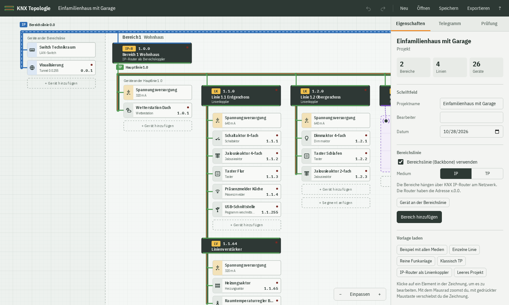
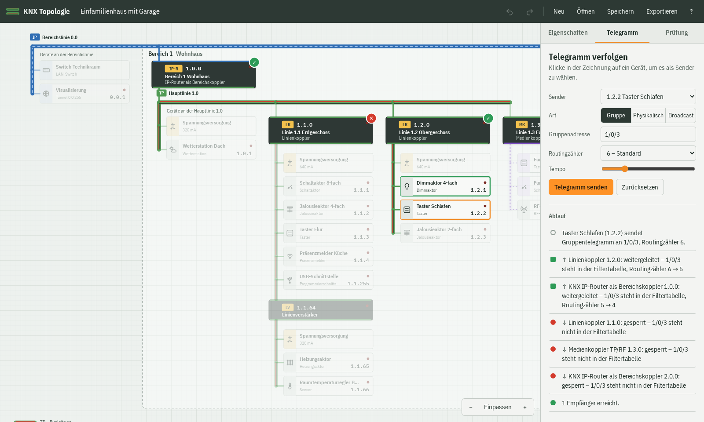

# KNX Topologie

Ein kleines Webtool, um KNX-Anlagen zu zeichnen und zu zeigen, wie Telegramme durch die Anlage laufen. Gemacht für Schulungen, zum Lernen und zum Ausprobieren.

**Einfach im Browser öffnen:** https://gtz187.github.io/knx-topologie/

Nichts installieren, kein Konto nötig. Deine Projekte bleiben in deinem Browser.



## Was du damit machen kannst

- **Topologie zeichnen**: TP-Linien, KNX IP und RF-Funk auf einer gemeinsamen Karte. Bereiche, Linien, Segmente und Geräte legst du per Klick auf die gestrichelten Felder an.
- **Adressen automatisch**: Unter dem Linienkoppler 1.1.0 heißt jedes Gerät 1.1.x. Nummerierst du die Linie um, wandern alle Adressen mit.
- **Telegramme verfolgen**: Im Reiter „Telegramm“ einen Teilnehmer anklicken – er sendet auf seiner Gruppenadresse. Man sieht, wie das Telegramm alle Teilnehmer der Linie gleichzeitig erreicht, wie die Empfänger quittieren und wie Koppler weiterleiten oder sperren.
- **Fehler einbauen**: Teilnehmer oder Koppler ausschalten. Bekommt der Sender keine Quittung, wiederholt er bis zu dreimal.
- **Funk verstehen**: Eine RF-Linie erscheint als kleiner Grundriss. Wände dämpfen, Beton blockt, Repeater frischen Telegramme auf. Reine Funkanlagen ohne Busleitung gehen auch.
- **ETS-Projekt importieren**: Eine .knxproj-Datei über „Öffnen“ laden – Topologie, Geräte, Adressen und Gruppenadressen werden übernommen. Alles bleibt im Browser. Passwortgeschützte Projekte vorher ohne Passwort exportieren.
- **Prüfen**: doppelte Adressen, fehlende Spannungsversorgung, zu viele Teilnehmer pro Segment.
- **Weitergeben**: als Datei speichern, als Bild (SVG/PNG) oder Adressliste (CSV) exportieren, drucken oder als Link teilen.



## Geräte

Teilnehmer (Taster, Aktoren, Melder …), Spannungsversorgung, Linienkoppler, Bereichskoppler, Linienverstärker, Segmentkoppler, KNX IP-Router, Medienkoppler TP/RF, USB- und IP-Schnittstelle, LAN-Switch und RF-Repeater. Welcher Koppler gebraucht wird, ergibt sich aus den Medien – hängt eine TP-Linie an einer IP-Hauptlinie, wird automatisch ein IP-Router daraus.

## Gut zu wissen

- Auf TP quittieren alle Empfänger gleichzeitig. Ein Linienkoppler quittiert auf seiner Seite und sendet das Telegramm auf der anderen Seite neu.
- KNX IP-Routing (Multicast) und KNX RF Ready kennen keine Quittung. KNX RF Multi quittiert per Fast-Ack – pro RF-Linie einstellbar.
- Die Simulation zeigt das Prinzip, sie ersetzt keine ETS. KNX Secure und Powerline sind nicht dabei.

## Mitmachen

Das Projekt gehört allen: **benutzen, kopieren, forken, umbauen, erweitern** – ausdrücklich erwünscht. Ideen und Fehler gern als Issue, Verbesserungen gern als Pull Request. Hauptsache, es macht Spaß.

Es ist reines HTML, CSS und JavaScript ohne Build-Schritt. Lokal starten:

```sh
python3 -m http.server 8000
# dann http://localhost:8000 öffnen
```

Tests der Simulationslogik (Node 20+): `npm test`

| Datei | Inhalt |
|---|---|
| `js/model.js` | Datenmodell, Geräte, Adressvergabe |
| `js/routing.js` | Telegramm-Simulation mit Quittung und Wiederholung |
| `js/rf.js` | Funkausbreitung, Wände, Repeater |
| `js/validate.js` | Prüfregeln |
| `js/ets.js` | Import von ETS-Projekten (.knxproj) |
| `js/layout.js`, `js/render.js` | Layout und Zeichnung |
| `js/sim.js`, `js/rfplan.js` | Animation und Grundriss-Editor |
| `js/app.js` | Oberfläche |
| `js/templates.js` | Vorlagen |

KNX ist eine Marke der KNX Association. Dieses Projekt ist unabhängig und nicht mit ihr verbunden.

## Lizenz

MIT – mach damit, was du willst.
